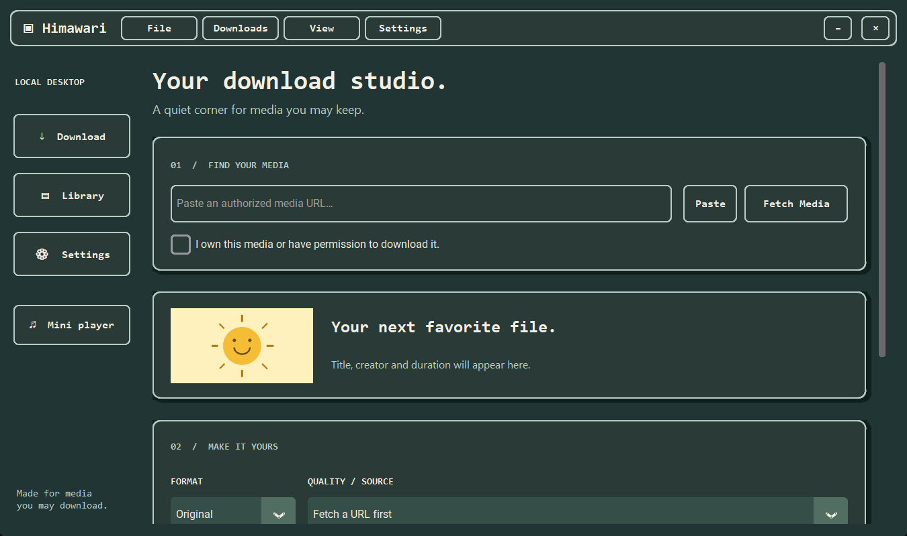
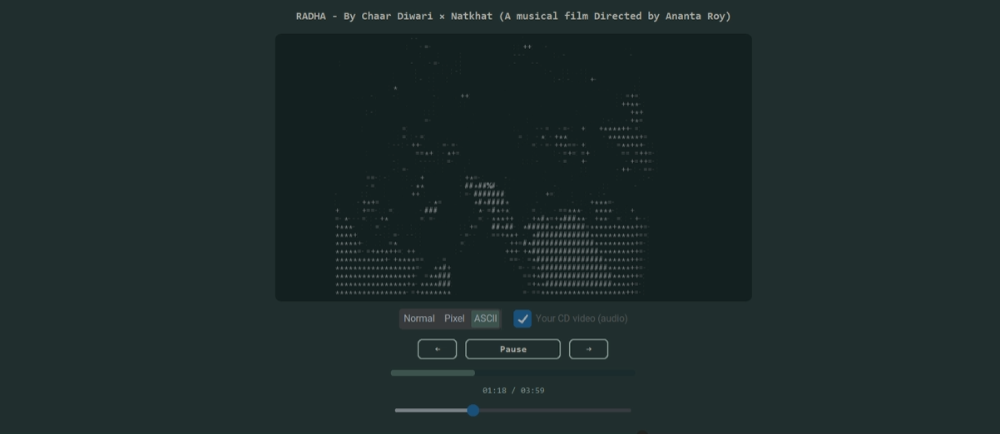

# Himawari 🌻

A cozy Python desktop media downloader and player, formerly SunDrop. **Himawari** is the Japanese word for sunflower.

Download media you own or have permission to save, keep it in a local library, and play video or music in a retro cyan-and-cream interface with Light and Dark modes.



## What it does

- Fetches a single media URL using yt-dlp and shows the title, artwork and available formats.
- Clearly separates **Video** from **Audio only**, with source quality choices.
- Combines separate video/audio streams with FFmpeg and checks the saved media with FFprobe.
- Keeps a local download library, thumbnails and MP3 artwork when available.
- Plays local video and audio with pause/resume, seeking, volume and previous/next library navigation.
- Offers optional **Normal, Pixel and ASCII** video views. These display effects leave your file unchanged.
- Plays the supplied CD reference clip silently as a looping music visual, displayed sideways in landscape.
- Supports Light/Dark appearance and scrolls through a native frame viewport to avoid canvas-scroll text artifacts on Windows.



## Download the source

Click **Code → Download ZIP** on this repository, then extract the ZIP into a folder you want to keep. Or clone it:

```powershell
git clone https://github.com/dipakdhurve9975-lgtm/himawari.git
cd himawari
```

This release contains Python source. An EXE or installer is not included.

## Windows setup

Install **Python 3.12** with the Windows Python launcher. FFmpeg/FFprobe are needed for merging separate streams, MP3 conversion and saved-stream verification. YouTube support also needs **Node.js 22 or newer** or **Deno 2.3 or newer** on PATH; Himawari enables an available Node/Deno runtime automatically. The requirements include yt-dlp's default EJS support components.

Open PowerShell in the extracted project folder and run these commands once:

```powershell
py -3.12 -m venv .venv
.\.venv\Scripts\python.exe -m pip install -r requirements.txt
```

Now double-click **Himawari.bat** to open the app. You can also run it directly:

```powershell
.\.venv\Scripts\pythonw.exe app.py
```

To make a Desktop shortcut, right-click **Himawari.bat → Show more options → Send to → Desktop (create shortcut)**. Keep the project folder in place. Windows shortcuts are created locally by the user; downloading the ZIP does not install Start menu entries automatically.

## Use the downloader

1. Paste a media URL and confirm you have permission to download it.
2. Click **Fetch Media**.
3. Choose **Video · MP4** for visuals, or **Audio only** for a music file. An M4A file has no video picture.
4. Choose the source quality and destination folder, then click **Download to my shelf**.
5. Use **Library → Play / Pause**, or **File** to open an existing local file.

Site availability and format support can change. Private, sign-in-restricted and DRM content are not bypassed. The app does not import browser credentials or cookies.

## Test

```powershell
.\.venv\Scripts\python.exe -m pytest tests -q
```

Tests cover URL validation, file naming, cancellation, history, artwork, real local HTTP downloads, video/audio merging, playback controls, display effects and the exact CD reference asset. External website downloads are not part of the automated test suite.

## Project files

| File | Purpose |
|---|---|
| `app.py` | Desktop interface and player controls |
| `core.py` | Media inspection, downloading and history |
| `player.py` | Local audio/video playback |
| `media.py` | Saved-stream inspection with FFprobe |
| `effects.py` | Read-only video effects and CD display rotation |
| `scrolling.py` | Native frame scrolling |
| `artwork.py` | Artwork caching and MP3 tags |
| `assets/` | App icon and supplied CD reference clip |
| `tests/` | Automated checks |

The app saves new downloads in `Downloads/Himawari` by default. The legacy `.sundrop` data folder is retained so an existing SunDrop library still opens. `HIMAWARI_DATA_DIR` can select another data location. User history, downloaded media and virtual environments are excluded from this repository.

The CD clip is supplied reference material; its provenance is documented in [assets/README.md](assets/README.md).
